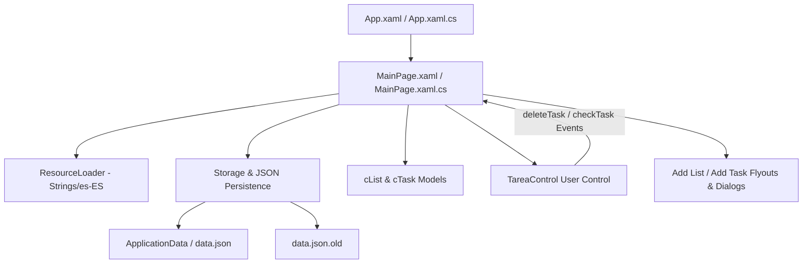

# Requirements

### Overview & Goals
The objective is to implement the complete "Mis Listas" (My Lists) UWP desktop application described in `mpaee-sesion5-taller.pdf`. The application is a task and list management tool designed to provide maximum user utility through intuitive task organization, resilient local JSON data persistence, multi-language support (I18n), and robust lifecycle management.

### Scope
#### In Scope
- **Project Configuration & Window Customization**: Fixed launch size (600x750), custom background, dynamic title, and application close confirmation interception (`confirmAppClose`).
- **Internationalization (I18n)**: Centralized string catalog in `Strings/es-ES/Resources.resw` referenced throughout XAML and code-behind via `ResourceLoader`.
- **Data Models & Persistence**: `cList` and `cTask` models, JSON serialization using `Newtonsoft.Json`, asynchronous loading/saving with automated backup creation (`datos.json.old`), and error handling for storage I/O.
- **Custom User Control**: `TareaControl` encapsulating task display, completion state toggling, deletion events, and inline text editing.
- **Core List & Task Management**:
  - Flyout for creating lists.
  - Confirmation dialog for deleting lists.
  - Flyout for adding tasks.
  - Event-driven deletion and completion toggling of tasks.
- **Extended Workshop Features (Ampliaciones)**:
  - Error handling and backup creation (`datos.json.old`) on save.
  - Task sorting (by name or date).
  - Task filtering (toggle active vs. finished, recover deleted tasks).
  - List color customization (`ColorPicker`) and task container background styling.
  - Task due dates (`DatePicker`) and visual indicators for overdue tasks.

#### Out of Scope
- Cloud synchronization or remote backend authentication (the app operates strictly on local desktop storage).
- Multi-window / multi-instance management.

### User Stories
- **As a user**, I want to organize my tasks into named lists so that I can categorize personal and work activities effectively.
- **As a user**, I want to mark tasks as completed or delete them so that my active task list reflects current priorities.
- **As a user**, I want to assign due dates and custom colors so that urgent tasks and list categories are instantly distinguishable.
- **As a user**, I want my task data and backups saved reliably upon exit so that no data is lost during unexpected shutdowns.

### Functional Requirements
- **FR-1**: Window must launch at 600x750 dimensions with localized title indicating the active list or "Sin Listas".
- **FR-2**: Attempting to close the window must trigger a confirmation dialog; confirming must trigger `saveData()` and exit.
- **FR-3**: User can create a new list with a custom name and color via the Add List Flyout.
- **FR-4**: User can delete the active list after confirming via a `ContentDialog`.
- **FR-5**: User can add tasks to the active list specifying name and optional due date (`DatePicker`).
- **FR-6**: Each task in `ListGrid` must display its name, completion checkbox/icon, and delete button.
- **FR-7**: Clicking a task's text enables inline editing to update its description.
- **FR-8**: Overdue uncompleted tasks must be visually emphasized (e.g., highlighted text/badge).
- **FR-9**: User can filter tasks (active vs. all, deleted/recoverable) and sort tasks by name or due date.
- **FR-10**: Application data must be stored in JSON format, creating a `.old` backup prior to overwriting.

### Non-Functional Requirements
- **Reliability & Resilience**: All file operations must be fault-tolerant with try-catch blocks to prevent application crashes on corrupted or locked data files.
- **Responsiveness**: All file I/O and dialog operations must use `async`/`await` to maintain UI thread fluidity.
- **Maintainability**: Clean component decoupling using custom event args (`deleteTaskEventArgs`, `checkTaskEventArgs`).

# Technical Design

### Current Implementation
- The repository contains an existing .NET 10 UWP project (`Mis Listas.csproj`) targeting `net10.0-windows10.0.26100.0`.
- Verified that the project builds cleanly via MSBuild (`C:\Program Files\Microsoft Visual Studio\18\Community\MSBuild\Current\Bin\MSBuild.exe`).
- Base files present: `App.xaml`, `App.xaml.cs`, `MainPage.xaml`, `MainPage.xaml.cs`, `Package.appxmanifest`.

### Key Decisions
- **Data Serialization Strategy**: Use `Newtonsoft.Json` for serialization of hierarchical `cList` and `cTask` objects, preserving compatibility with the course specifications.
- **Local Storage Strategy**: Primary storage in `ApplicationData.Current.LocalFolder` with fallbacks and backup generation (`data.json.old`), ensuring transactional safety when saving data.
- **Component Architecture**: Decouple task item logic into `TareaControl` user control, utilizing routed custom events (`deleteTask`, `checkTask`) to bubble actions up to `MainPage`.
- **Localization Pattern**: Use `ResourceLoader` and `.resw` resource files under `Strings/es-ES/` to centralize all UI strings.

### Data Models / Contracts
```csharp
namespace Mis_Listas.Models
{
    public class cTask
    {
        public string name { get; set; } = string.Empty;
        public bool finished { get; set; } = false;
        public bool active { get; set; } = true;
        public DateTime? expired { get; set; } = null;
        public DateTime created { get; set; } = DateTime.Now;
    }

    public class cList
    {
        public int id { get; set; }
        public string name { get; set; } = string.Empty;
        public string color { get; set; } = "#FFA500"; // Hex color or name
        public List<cTask> tasks { get; set; } = new List<cTask>();
    }

    public class deleteTaskEventArgs : EventArgs
    {
        public cTask task { get; set; }
        public deleteTaskEventArgs(cTask t) => task = t;
    }

    public class checkTaskEventArgs : EventArgs
    {
        public cTask task { get; set; }
        public checkTaskEventArgs(cTask t) => task = t;
    }
}
```

### File Structure
```
Mis Listas/
├── Assets/
│   ├── Data/
│   │   └── data.json
│   └── images layout/
│       ├── addList.png
│       ├── deleteList.png
│       ├── addTask.png
│       ├── deleteTask.png
│       └── check.png
├── Controls/
│   ├── TareaControl.xaml
│   └── TareaControl.xaml.cs
├── Models/
│   ├── cList.cs
│   └── cTask.cs
├── Strings/
│   └── es-ES/
│       └── Resources.resw
├── App.xaml
├── App.xaml.cs
├── MainPage.xaml
├── MainPage.xaml.cs
├── Package.appxmanifest
└── Mis Listas.csproj
```

### Architecture Diagram


### Risks & Mitigations
- **File Access Restrictions in UWP**: Direct writing to `Package.Current.InstalledLocation` at runtime is restricted in sandboxed packaged apps. *Mitigation*: Perform all runtime reads/writes in `ApplicationData.Current.LocalFolder`, seeding from bundled `Assets/Data/data.json` on first run if local file does not exist.
- **App Close Interception**: `confirmAppClose` requires restricted capability in manifest. *Mitigation*: Declare `rescap:Capability Name="confirmAppClose"` and handle `PreviewCloseRequested` / `OnCloseRequest` properly.

# Testing

### Validation Approach
Verification will be conducted using automated builds, functional unit tests where applicable, and manual verification check-points for UI behavior and data persistence.

### Key Scenarios
1. **Application Launch & Data Seed**:
   - Verify application loads bundled or stored `data.json`.
   - Verify lists populate into `slctList` ComboBox and default list displays its tasks.
2. **List CRUD Operations**:
   - Add new list via flyout -> Verify list appears in dropdown and selection switches to it.
   - Delete current list -> Confirm deletion dialog -> Verify list is removed and next available list is displayed.
3. **Task Operations**:
   - Add task with due date -> Verify task appears in `ListGrid`.
   - Toggle task completion -> Verify visual check/strikethrough styling updates.
   - Inline edit task -> Modify text -> Verify changes persist in memory and UI.
   - Delete task -> Verify task is removed from UI.
4. **Data Persistence & Backup**:
   - Trigger application close -> Confirm dialog -> Verify `data.json` is updated and `data.json.old` is created.
   - Re-launch application -> Verify all changes are accurately reloaded.
5. **Extensions**:
   - Sort tasks by name and due date -> Verify order updates.
   - Filter active/completed/deleted tasks -> Verify list reflects filter criteria.
   - Overdue highlighting -> Set past date on uncompleted task -> Verify visual alert.

### Edge Cases
- Empty task list or deletion of all lists (UI displays fallback empty state message).
- Special characters in task and list names (proper JSON escaping).
- Corrupted JSON data file (graceful fallback to backup or default seed without crashing).

# Delivery Steps

### ✓ Step 1: Setup Project Infrastructure, Localization, and Window Configuration
Verify and configure the core project foundation, manifest capabilities, and localization setup.

- Configure `Package.appxmanifest` with `rescap:Capability Name="confirmAppClose"` and set default language to `es-ES`.
- Create `Strings/es-ES/Resources.resw` and populate all UI string resources for dialogs, tooltips, list headers, task actions, and confirmation prompts.
- Configure `MainPage.xaml` and `MainPage.xaml.cs` window parameters (dimensions 600x750, title loaded from resource loader, close interception dialog).
- Import required image assets into `Assets/images layout/` (`addList.png`, `deleteList.png`, `addTask.png`, `deleteTask.png`, `check.png`).

### ✓ Step 2: Implement Data Models, Serialization, and Storage with Backup
Implement data structures and robust storage operations including automatic serialization and backup mechanism.

- Add NuGet package `Newtonsoft.Json` to project dependencies.
- Define `cTask` model with properties: `name` (string), `finished` (bool), `active` (bool/deleted flag), `expired` (DateTime?), `created` (DateTime).
- Define `cList` model with properties: `id` (int), `name` (string), `color` (string/hex), `tasks` (List<cTask>).
- Create `Assets/Data/data.json` default seed data with Content build action.
- Implement `StorageService` / data helper with `loadData()`, `saveData()`, error handling, and automated creation of backup file `datos.json.old` prior to overwriting.

### ✓ Step 3: Develop TareaControl User Component and Main Page Layout
Build the custom task user control and the main application layout grid.

- Create `TareaControl.xaml` and `TareaControl.xaml.cs` encapsulating task item rendering, completion status visual cues (strikethrough / gray styling), delete button, and check/toggle button.
- Implement custom event args `deleteTaskEventArgs` and `checkTaskEventArgs` with event dispatchers `deleteTask` and `checkTask`.
- Add inline task text editing capability (clicking on text switches to inline `TextBox` to update description).
- Implement main application UI in `MainPage.xaml`: header section with `slctList` ComboBox, add/delete list buttons, and task items grid container.
- Implement `loadTasks()` in `MainPage.xaml.cs` to dynamically populate the task container with `TareaControl` instances.

### ✓ Step 4: Implement List and Task Management Operations
Implement interactive flyouts and dialogs for managing lists and individual tasks.

- Implement Add List Flyout (`flyoutNuevaLista`) with list name input, accept and cancel event handlers.
- Implement Delete List confirmation dialog (`ContentDialog`) that asks for confirmation before removing the selected list and its tasks.
- Implement Add Task Flyout (`flyoutNuevaTarea`) with task name input, accept and cancel event handlers.
- Implement task deletion handler (`deleteTask`) and task completion toggle handler (`checkTask`) updating model state and refreshing UI.
- Wire application close confirmation dialog (`OnCloseRequest`) to persist changes via `saveData()` before closing.

### ✓ Step 5: Implement Extended Enhancements (Sorting, Filtering, ColorPicker, Due Dates)
Deliver advanced features including sorting, task filtering, list color picker, and date picker with overdue highlighting.

- Implement task sorting controls allowing sorting by task name or creation/due date.
- Add task view filtering toggles: active only vs. all tasks (including finished), and a view to inspect/recover soft-deleted tasks.
- Integrate `ColorPicker` in the Add List flyout, applying the selected background color dynamically to the task container grid.
- Integrate `DatePicker` in the Add Task flyout to set expiration dates (`expired`), and visually highlight overdue uncompleted tasks (e.g. red accent / warning badge).